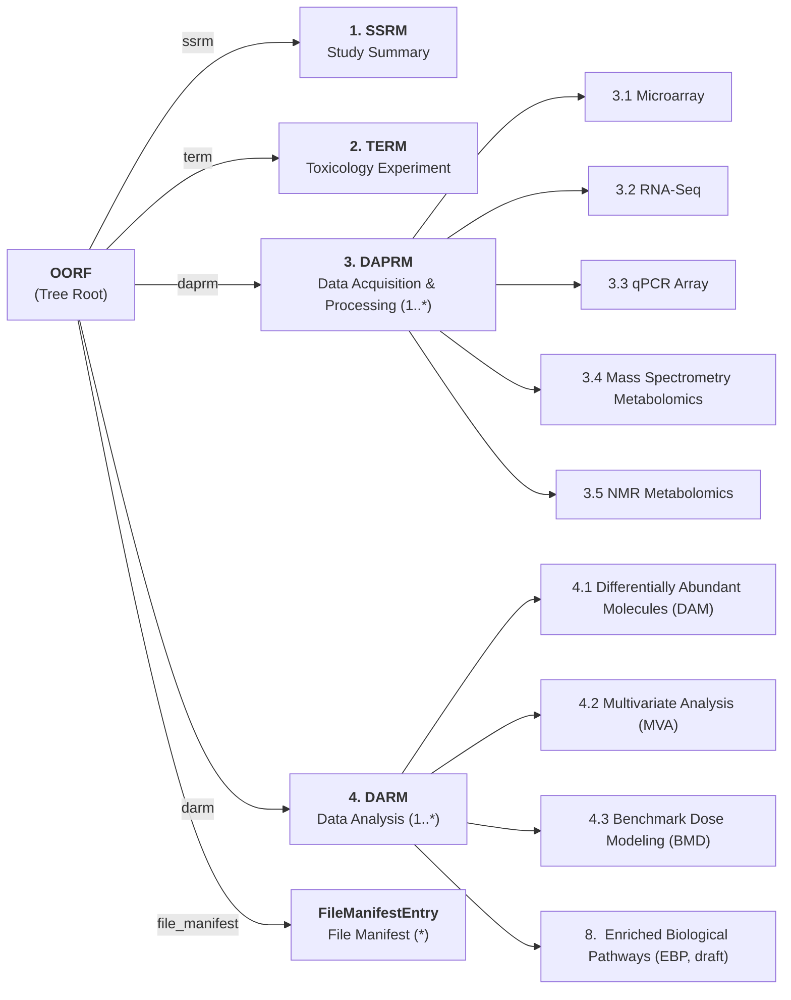

# maoorf — Machine-Actionable OECD Omics Reporting Framework

A modular [LinkML](https://linkml.io/) data model for the **OECD Omics Reporting Framework (OORF)**, designed to make regulatory toxicology omics metadata machine-actionable, extensible, and FAIR.

!!! warning "Work in Progress & Community Initiative"
    - **Community-Driven Effort:** This machine-actionable schema is **not officially endorsed by the OECD**. It is an independent formalization effort initiated by the toxicology community within **[PARC (Partnership for the Assessment of Risks from Chemicals)](https://www.eu-parc.eu/)** based on the published [OECD Omics Reporting Framework (2023)](https://doi.org/10.1787/6bb2e6ce-en).
    - **Work in Progress:** This repository is under active development. The current schema provides a 1:1 structural translation of the official OORF Excel reporting templates (with exact element mappings to `oecd_oorf_2023`) as the foundation for upcoming ontology alignment and FAIRification.
    - **AI-Assisted Development:** The initial translation of the OECD OORF Excel template and guidance document into modular LinkML was assisted by generative AI (Google Gemini / Antigravity) under human direction and is actively undergoing domain-expert review and curation.

---

## Start Here: Explore the Schema from the `OORF` Root Class

Rather than browsing the flat alphabetical list of all ~200 classes and ~700 slots, **start at the top-level root class and follow its modules down the hierarchy**:

👉 **[Start at the Root Class: `OORF`](elements/classes/OORF.md)**

---

## Module Entry Points

Each OORF submission ([`OORF`](elements/classes/OORF.md)) is composed of the following modular building blocks:

| OORF Section | Entry Point Class | Purpose |
| :--- | :--- | :--- |
| **Root Submission** | **[`OORF`](elements/classes/OORF.md)** | Top-level container combining one `SSRM`, one `TERM`, one or more `DAPRM`s, one or more `DARM`s, and a `FileManifestEntry` list |
| **Module 1: Study Summary** | **[`SSRM`](elements/classes/SSRM.md)** | High-level study overview, identifiers, and executive summary of the experiment, assays, and analyses |
| **Module 2: Toxicology Experiment** | **[`TERM`](elements/classes/TERM.md)** | Study rationale, test/control chemical items, in vivo / in vitro test system characteristics, study design, treatment conditions, and sample collection |
| **Module 3: Data Acquisition & Processing (`DAPRM`)** | **[`DAPRM`](elements/classes/DAPRM.md)** *(Abstract)* | Base class for omics assay acquisition and pre-processing modules:<ul><li>**3.1 Microarray:** [`MicroarrayDAPRM`](elements/classes/MicroarrayDAPRM.md)</li><li>**3.2 RNA-Seq & Targeted RNA-Seq:** [`RNASeqDAPRM`](elements/classes/RNASeqDAPRM.md)</li><li>**3.3 qRT-PCR Array:** [`QRTPCRDAPRM`](elements/classes/QRTPCRDAPRM.md)</li><li>**3.4 Mass Spectrometry (LC-MS / GC-MS):** [`MassSpectrometryDAPRM`](elements/classes/MassSpectrometryDAPRM.md)</li><li>**3.5 NMR Metabolomics:** [`NMRDAPRM`](elements/classes/NMRDAPRM.md)</li></ul> |
| **Module 4: Data Analysis (`DARM`)** | **[`DARM`](elements/classes/DARM.md)** *(Abstract)* | Base class for statistical and bioinformatics analysis modules (inherits common `inputs` and `outputs` slots):<ul><li>**4.1 Differentially Abundant Molecules:** [`DAMDARM`](elements/classes/DAMDARM.md)</li><li>**4.2 Multivariate Statistical Analysis:** [`MVADARM`](elements/classes/MVADARM.md)</li><li>**4.3 Benchmark Dose (BMD) Modeling:** [`BMDDARM`](elements/classes/BMDDARM.md)</li><li>**8. Enriched Biological Pathways (Draft):** [`EBPDARM`](elements/classes/EBPDARM.md)</li></ul> |
| **File Manifest & Shared Entities** | **[`FileManifestEntry`](elements/classes/FileManifestEntry.md)** | Tracks all machine-readable data objects, metadata tables, scripts, and MD5 checksums. Shared structures also include [`SoftwareDocumentation`](elements/classes/SoftwareDocumentation.md) and [`AssayExperimentalDesign`](elements/classes/AssayExperimentalDesign.md) |

---

## Reference Index

- [Full Alphabetical Schema Index (All Classes, Slots & Types)](elements/index.md)
- [About `maoorf` & Upstream OECD Specifications](about.md)
